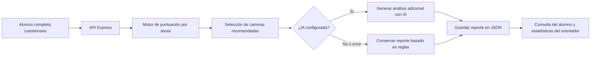

<div align="center">

# OrientaIA — Proyecto académico de orientación vocacional

[](https://react.dev/)
[](https://nodejs.org/)
[](https://expressjs.com/)

**Proyecto de facultad desarrollado por Emanuel Paz y Juan Bertossi.** No es un producto comercial ni un sistema en uso continuo.

</div>

## Qué hace el proyecto

En lugar de analizar manualmente cada cuestionario de orientación vocacional, el sistema recibe las respuestas de un estudiante, calcula afinidades por área, selecciona carreras relacionadas y genera un reporte que puede consultar el orientador.

**Flujo implementado:**



**Entrada:** datos del alumno y respuestas a cinco preguntas.  
**Salida:** puntajes, tres áreas principales, hasta cinco carreras recomendadas y, opcionalmente, un análisis en lenguaje natural generado por IA.  
**Persistencia:** archivos JSON locales.  
**Comportamiento ante fallas:** si el servicio de IA no está configurado o falla, el reporte se guarda usando el motor de reglas.

## Arquitectura resumida

- **Interfaz:** React + Vite para alumnos, orientadores y configuración de IA.
- **API:** Express con endpoints para alumnos, cuestionarios, reportes y estadísticas.
- **Lógica de negocio:** cálculo de puntajes y recomendación de carreras.
- **Integración opcional:** adaptadores para Ollama, OpenAI, Claude y Gemini.
- **Datos:** archivos JSON; esta versión no requiere configurar un servidor SQL.

## Demostración sugerida para el coloquio

1. Iniciar el proyecto con `npm run install:all` (primera vez) y `npm run dev`.
2. Abrir `http://localhost:5173`.
3. Crear un estudiante ficticio y responder el cuestionario.
4. Mostrar el reporte generado sin intervención manual.
5. Consultar las estadísticas del orientador y explicar cómo funciona el modo opcional con IA.

**Nota:** el README documenta el flujo previsto a partir del código fuente; esto no sustituye probar la ejecución local antes del coloquio.

---

## Documentación de instalación y uso

Asistente de orientacion vocacional para alumnos de los ultimos anos del secundario (5to y 6to ano). El alumno completa un cuestionario, la IA analiza su perfil y genera un reporte con areas de afinidad y carreras recomendadas. Incluye panel del orientador con estadisticas grupales.

## Requisitos previos

- [Node.js](https://nodejs.org) v18 o superior
- [Ollama](https://ollama.com) (para usar IA local gratuita) — opcional

## Instalacion

Clonar el repositorio y desde la raiz ejecutar:

```bash
npm run install:all
```

Esto instala las dependencias del proyecto raiz, backend y frontend.

## Ejecucion

```bash
npm run dev
```

Levanta backend y frontend en paralelo:

- Frontend: `http://localhost:5173`
- Backend API: `http://localhost:3001`

## Configurar IA (opcional)

El sistema funciona sin IA — genera reportes con un motor de reglas. Para activar analisis personalizados con lenguaje natural hay dos opciones:

### Opcion A — Ollama (gratuito, local)

1. Instalar Ollama desde https://ollama.com
2. Abrir una terminal y ejecutar:
   ```bash
   ollama pull phi3
   ollama serve
   ```
3. En la app: boton **⚙ IA** → seleccionar **Ollama** → Guardar.

### Opcion B — API paga (OpenAI, Claude, Gemini)

1. Obtener una API key del proveedor elegido.
2. En la app: boton **⚙ IA** → seleccionar el proveedor → pegar la key → Guardar.

La key se guarda solo en el navegador, nunca en el servidor.

## Tecnologias

- Frontend: React + Vite
- Backend: Node.js + Express
- Persistencia: archivos JSON locales
- IA: capa multi-proveedor (Ollama, OpenAI, Claude, Gemini)

## Estructura del proyecto

```
OrientaIA/
  backend/
    src/
      server.js          # API REST con Express
      ai/
        index.js         # Selector de proveedor de IA
        prompt.js        # Construccion del prompt vocacional
        providers/
          ollama.js      # Ollama local
          openai.js      # OpenAI
          claude.js      # Anthropic Claude
          gemini.js      # Google Gemini
    data/
      careers.json       # Catalogo de carreras
      students.json      # Alumnos registrados
      reports.json       # Reportes generados
  frontend/
    src/
      main.jsx           # App React (alumno + orientador + config IA)
      styles.css         # Estilos
```

## Endpoints de la API

| Metodo | Ruta | Descripcion |
|--------|------|-------------|
| GET | `/api/health` | Estado del servidor |
| GET | `/api/careers` | Catalogo de carreras |
| GET | `/api/questionnaire` | Preguntas del cuestionario |
| POST | `/api/students` | Registrar alumno |
| POST | `/api/questionnaire` | Enviar respuestas y generar reporte |
| GET | `/api/reports/:studentId` | Obtener reporte de un alumno |
| GET | `/api/orientador/stats` | Estadisticas grupales |

El endpoint `POST /api/questionnaire` acepta headers opcionales para IA:
- `x-ai-provider`: `ollama`, `openai`, `claude` o `gemini`
- `x-ai-key`: API key del proveedor (no requerida para Ollama)
- `x-ai-model`: modelo a usar (phi3 para Ollama por defecto)

